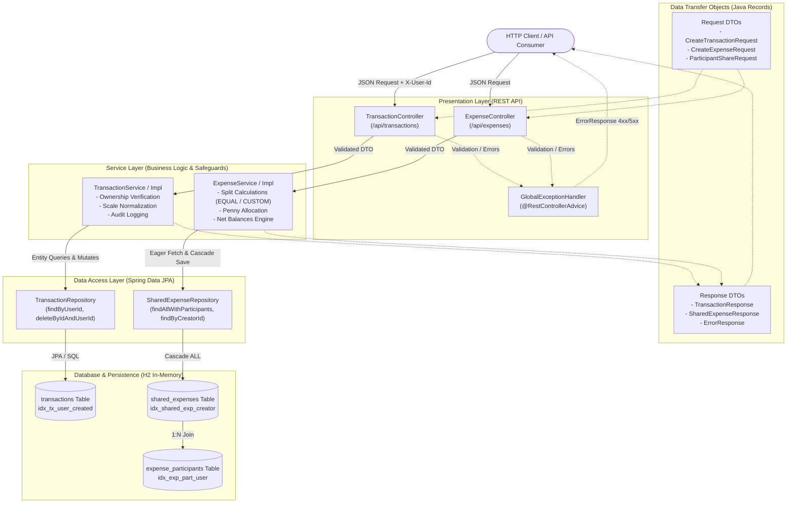

# FinTrack System Architecture

FinTrack is engineered as an enterprise-grade financial management platform following a strict multi-tiered layered architecture.
Incoming HTTP client requests hit the Presentation Layer, where REST controllers (`TransactionController`, `ExpenseController`) enforce Jakarta Bean Validation constraints and extract caller context.
Valid requests are converted from immutable record DTOs and passed to the Business Logic Service Layer (`TransactionServiceImpl`, `ExpenseServiceImpl`).
The service layer encapsulates financial invariants, caller ownership authorization, `BigDecimal` scale normalization, and penny-remainder allocation algorithms.
Data persistence is delegated to the Data Access Layer using Spring Data JPA Repositories (`TransactionRepository`, `SharedExpenseRepository`).
Repositories execute type-safe queries and optimized batch fetches against an in-memory H2 relational database configured with composite index tuning.
Domain entities (`Transaction`, `SharedExpense`, `ExpenseParticipant`) maintain strict encapsulation, audit timestamps, and lifecycle pre-persist hooks.
Cross-cutting concerns are decoupled using a centralized `@RestControllerAdvice` (`GlobalExceptionHandler`) that translates domain exceptions into standard HTTP error envelopes.
Structured audit logging via SLF4J is embedded across all mutation operations to ensure financial traceability and compliance.
The entire architecture guarantees that balance settlements across all multi-party expenses maintain a strict zero-sum invariant.

